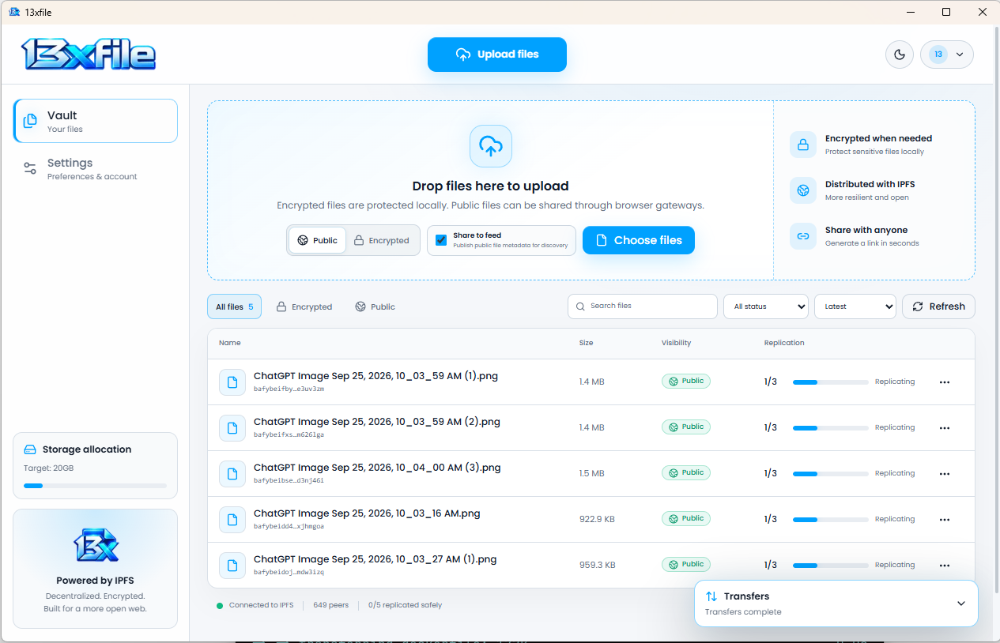
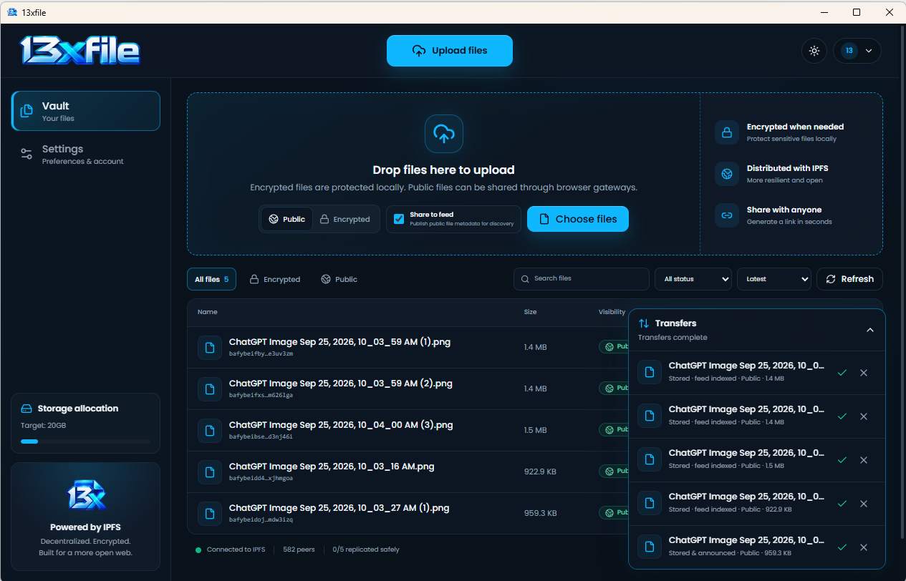
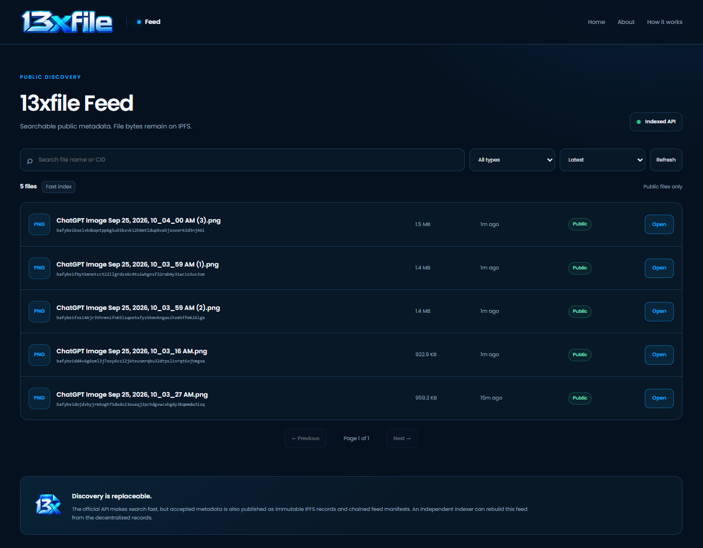
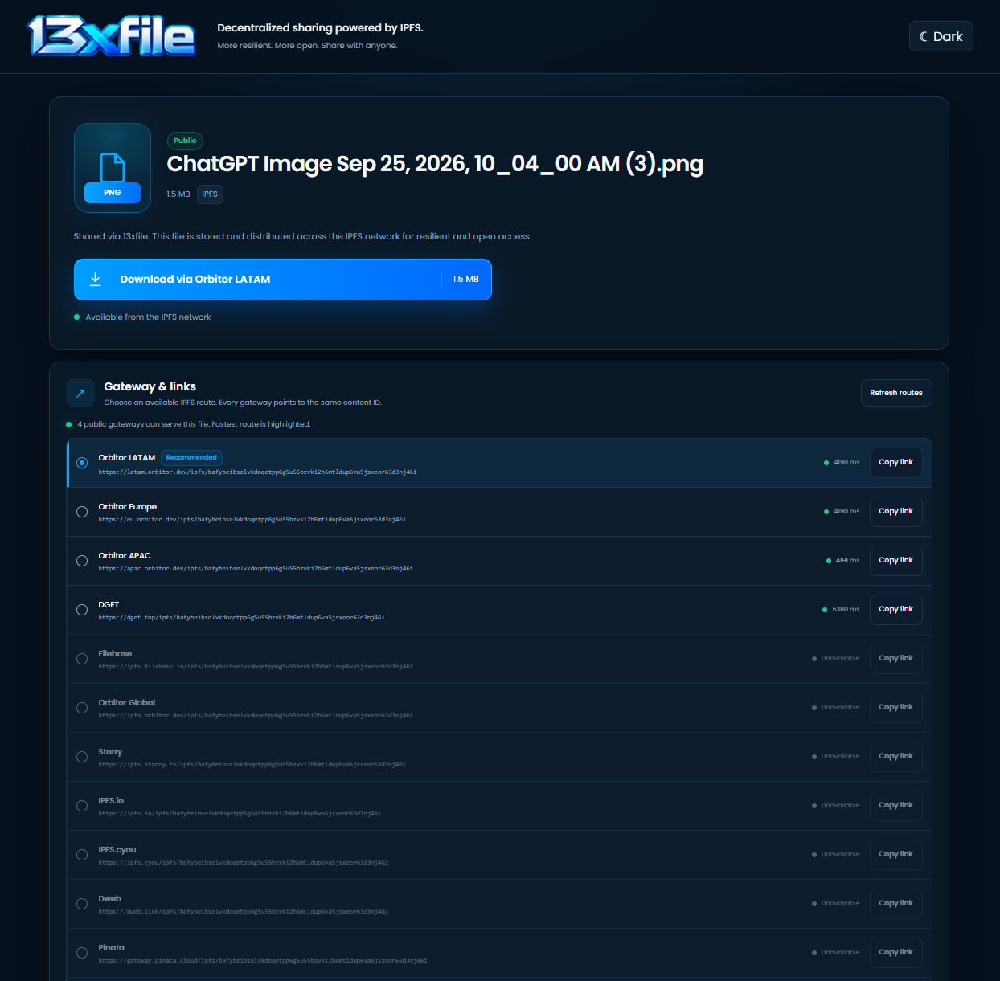

# 13xfile

13xfile is a decentralized encrypted storage network built around content-addressed IPFS blocks, signed device metadata operations, and independent storage peers.

## Interface preview

### Desktop

The desktop client supports public and encrypted uploads, IPFS replication status, transfer tracking, browser sharing, and local-first vault management. **Share to feed is temporarily disabled.**

| Light theme | Dark theme |
| --- | --- |
|  |  |

### Feed and public sharing

The share page provides direct browser downloads from IPFS. The public feed is paused for this launch; its existing interface and code are retained for a future rollout.

| Feed preview (paused) | Share page |
| --- | --- |
|  |  |

Deployment preparation for the main website and share page: [Netlify deployment guide](docs/NETLIFY_DEPLOYMENT.md). Browser downloads go directly to IPFS gateways; the feed/API are not part of this launch.

## MVP layout

```text
13xfile/
├── node/       headless storage peer
├── desktop/    standalone desktop application
├── web/        main centralized product website (13xfile.app)
├── feed/       public feed frontend (feed.13xfile.app)
├── share/      static public-file receiver page (share.13xfile.app)
├── api/        replaceable feed discovery/index API (api.13xfile.app)
└── docs/
```

13xfile does not use a central storage API for file bytes. The optional feed service is a centralized discovery/indexing convenience layer only: public file metadata is stored on IPFS, feed manifests are chained on IPFS/IPNS, and the SQLite index can be rebuilt or replaced.

## MVP protocol

Each device has its own Ed25519 device identity. Vault metadata is represented as signed append-only operations such as:

- `file.add`
- `file.remove`
- `replica.ack`

A replica is counted only after a distinct device signs a receipt after completing its IPFS pin **and** that device has a recent signed heartbeat. The desktop therefore shows active `n / target` durability instead of inferring replicas from CID/provider announcements or counting an offline device forever.

IPNS is still used as the mutable discovery pointer for the merged vault operation log. The current MVP retains the shared vault publishing key derived from the recovery code; replacing that final shared writer with a stronger multi-writer discovery layer remains post-MVP work.

## Private files

New private uploads use:

1. a random 256-bit per-file key;
2. chunked AES-256-GCM encryption before IPFS;
3. a vault-derived AES-GCM key-wrap around the random file key.

Storage peers only need the encrypted CID and wrapped-key metadata. They do not need the plaintext file key.

Older private files from the first prototype remain readable through the legacy deterministic-key fallback.

## Desktop MVP

The Wails desktop client owns its own node and Kubo runtime. Current features include:

- create/join vault onboarding and recovery-code reminder
- drag/drop and multi-file uploads
- three concurrent transfer workers
- persistent transfer journal and restart recovery
- Google Drive-style transfer tray
- public-by-default uploads with optional local encryption
- signed replica receipts and configurable replication target
- file details with individual device receipts
- search
- native save-to-download-folder
- signed metadata removal/tombstones
- system tray / close-to-background behavior
- optional start-at-login
- configurable storage allocation
- public HTTPS sharing
- selectable independent public-IPFS download mirrors
- `x13file://` app-share deep-link support
- legacy `13xfile://` link parsing
- feed metadata publishing code retained for later (currently disabled)

See `desktop/README.md`.

### Local testing / development

13xfile is currently intended to be tested locally. The default Docker stack starts the product website and share page only; the paused public feed, API, and feed-side Kubo node require the optional `feed` profile. The desktop client runs natively on the host OS.

#### Requirements

All platforms need:

- Git
- Docker with Docker Compose (`docker compose`)
- Go **1.26+** for the desktop app
- internet access on first desktop launch so 13xfile can bootstrap its managed Kubo runtime

Node.js/npm is required when using the Windows `dev.cmd` helper or when rebuilding the React frontend. If you launch the desktop manually with `go run .`, the committed `desktop/frontend/dist` output is enough for a normal local test.

Platform-specific desktop requirements:

- **Windows 10/11:** WebView2 Runtime (normally already installed)
- **macOS:** Xcode Command Line Tools (`xcode-select --install`)
- **Linux:** GCC/pkg-config plus GTK4 and WebKitGTK 6.0 development packages. On Ubuntu 24.04 / Debian 13-style systems:

```bash
sudo apt update
sudo apt install -y build-essential pkg-config libgtk-4-dev libwebkitgtk-6.0-dev
```

On Ubuntu 22.04 / Debian 12-style systems that only provide WebKit2GTK 4.1, install the legacy dependencies instead:

```bash
sudo apt update
sudo apt install -y build-essential pkg-config libgtk-3-dev libwebkit2gtk-4.1-dev
```

Then launch the desktop with `go run -tags gtk3 .` instead of plain `go run .`.

#### 1. Clone the project

```bash
git clone https://github.com/bastilavarias/13xfile.git
cd 13xfile
```

#### 2. Start the local website and share page

**Windows:**

```powershell
.\\pages.cmd
```

**macOS / Linux:**

```bash
docker compose up --build
```

`pages.cmd` is only a convenience wrapper around the same Docker Compose command.

The stack exposes:

```text
Main      http://127.0.0.1:8080/
Share     http://127.0.0.1:8082/
```

The feed, API, and feed-side Kubo node are disabled in the default Docker Compose profile. To restore their local development stack later, use `docker compose --profile feed up --build`. Existing feed volumes are preserved.

#### 3. Run the desktop client

Open a second terminal while the Docker stack is still running.

**Windows (recommended helper):**

```powershell
.\\dev.cmd -NoPull
```

The helper rebuilds the desktop frontend and launches the current checkout. Feed publishing stays disabled.

To run it manually from PowerShell instead:

```powershell
cd desktop
go run .
```

From Windows Command Prompt (`cmd.exe`):

```cmd
cd desktop
go run .
```

**macOS:**

```bash
xcode-select --install   # only needed once
cd desktop
go run .
```

**Linux (GTK4 / WebKitGTK 6.0):**

```bash
cd desktop
go run .
```

For the legacy GTK3 / WebKit2GTK 4.1 setup described above:

```bash
cd desktop
go run -tags gtk3 .
```

The first desktop launch bootstraps its own managed Kubo runtime under `~/.13xfile-desktop`. A separately installed IPFS daemon is not required.

#### 4. Test public browser sharing

In the desktop app:

1. Select **Public** and upload a file.
2. Create a public web share link.
3. Open the link on the hosted `share.13xfile.app` page when deployed, or set `WEB_SHARE_BASE_URL=http://127.0.0.1:8082` explicitly for local testing.

`Share to feed` is paused. The upload remains on IPFS and does not require the feed index.

#### Stop or reset the local stack

Stop attached containers with `Ctrl+C`, then clean up containers/networks with:

```bash
docker compose down
```

Do not use `docker compose down -v` for routine cleanup: it would delete stored feed/index data, even while the feed is paused.

#### Pull latest changes

**Windows:**

```powershell
.\\pull.cmd
```

**macOS / Linux:**

```bash
git switch main
git pull --ff-only origin main
```

The Windows pull helper safely resets only generated `desktop/frontend/dist` output and refuses to overwrite real source changes.

#### Rebuild the desktop frontend manually

Only needed when modifying the UI:

```bash
cd desktop/frontend
npm ci
npm run build
```

Then return to `desktop/` and run `go run .` using the platform-specific `FEED_API_URL` command above.

## Headless node

`13xfile-node` is the always-on/server peer. It self-manages a pinned Kubo runtime, keeps an isolated IPFS repository, follows vault metadata, pins learned CIDs, and publishes signed replica receipts after successful storage.

See `node/README.md`.

## Remaining MVP limitations

- IPNS discovery still uses shared recovery-code publishing authority.
- Every joined peer currently attempts to replicate every vault file; storage placement/leases are not yet selective.
- Private browser sharing is intentionally deferred.
- Public browser sharing currently uses a temporary static-page hosting path until share.13xfile.app is deployed.
- Feed publisher metadata is not yet cryptographically signed by the desktop device; the v1 record format reserves a signature field for that next step.
- Mobile remains deferred until the desktop/node protocol settles.
